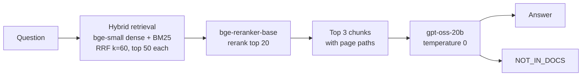

# RAG Reliability Service

[](https://github.com/1ow1atency/rag-reliability-service/actions/workflows/ci.yml)

A retrieval-augmented question-answering service over the Kubernetes documentation (concepts and tasks, pinned to one commit). It is evaluated against a closed-book baseline on a 49-question set, with retrieval, answer quality and abstention on unanswerable questions measured separately. It is deployed with FastAPI, Docker and Kubernetes, with a load test on a single-node cluster.

## Key results

All numbers come from `results/metrics/`. The retrieval and generation setups were chosen on the dev split and locked before a single run on test. Details: [docs/evaluation.md](docs/evaluation.md).

**Retrieval** (chunk-level: a top-k chunk from the right page contains the question's evidence sentence; 17 dev / 19 test questions)

| Setup | Dev R@3 | Dev MRR@10 | Test R@1 | Test R@3 | Test MRR@10 | Top-3 tokens (test) |
|---|---|---|---|---|---|---|
| **Final:** fixed 512-token chunks + hybrid + bge-reranker | 16/17 | 0.819 | 14/19 | 17/19 | 0.829 | 1,481 |
| Fixed 512-token chunks, dense only | 11/17 | 0.692 | 10/19 | 14/19 | 0.647 | 1,418 |
| Heading chunks + hybrid + bge-reranker | 15/17 | 0.700 | 13/19 | 18/19 | 0.825 | 959 |

**RAG vs closed-book** (`gpt-oss-20b`, 21 answerable test questions, judged by `gpt-oss-120b`)

| Mode | Correct | Incorrect | Not attempted |
|---|---|---|---|
| Closed-book | 11/21 (52%) | 10/21 (48%) | 0 |
| RAG | 17/21 (81%) | 3/21 (14%) | 1/21 (5%) |

Paired: both correct 10, RAG only 7, closed-book only 1, both wrong 3. RAG − closed-book is **+28.6 points, 95% bootstrap CI [+4.8, +52.4]** (10,000 question resamples, seed 42). Without the two hand-written test questions (q002, q004): +31.6 points, CI [+5.3, +57.9]. With RAG, 16 of the 17 questions whose evidence chunk was in the top 3 were answered correctly.

**Unanswerable questions** (4 test questions whose answer is not in the docs)

| Mode | Abstained | Answered |
|---|---|---|
| Closed-book | 0/4 | 4/4 (all made-up specific values, e.g. "110 containers", "$300") |
| RAG | 4/4 (`NOT_IN_DOCS`) | 0/4 |

## Architecture



- **Hybrid retrieval:** fixed 512-token chunks (510-token cap, 15% overlap), searched with `BAAI/bge-small-en-v1.5` embeddings in local Qdrant and with BM25; the two top-50 lists are merged by reciprocal rank fusion (k=60).
- **Reranking:** `BAAI/bge-reranker-base` scores the top 20 fused chunks as one cross-encoder batch; each pod reranks one request at a time, and other requests queue.
- **Generation:** the top 3 chunks, labelled with their page paths, go to `openai/gpt-oss-20b` on Groq at temperature 0, with an instruction to answer only from them.
- **Answer or abstention:** if the chunks do not contain the answer, the model replies `NOT_IN_DOCS`, which the API returns as `"abstained": true`.

The settings are locked in [configs/final_retrieval.json](configs/final_retrieval.json).

## Deployment and load testing

- **Docker:** a multi-stage, CPU-only image runs as a non-root user. The docs, indexes and models are baked in at build time, so startup downloads nothing. A change to the service code rebuilds in seconds.
- **Kubernetes:** the manifests in [k8s/](k8s/) (namespace, ConfigMap, Deployment with startup, readiness and liveness probes, ClusterIP Service, HPA) are tested on OrbStack's single-node cluster, with 2 CPU / 2.5 Gi per pod.
- **Load test** (rounds 1 and 2, stub LLM, so reranking only): in round 1, one pod running six concurrent reranks was **OOM-killed** and every request failed. Each rerank needs about 1.2 GiB of process memory. A one-rerank-at-a-time guard (a queue, with a 503 and `Retry-After` when it is full) fixed this: round 2 had no OOM kills, restarts or 503s, and one replica held flat at about 0.09 requests/s with 3 and 6 clients (0.091, 0.087; the 1-client cell's recorded 0.053 is a test-driver artifact). Three replicas reached about 0.11 requests/s with 3 and 6 clients on the shared Mac CPUs. Details: [docs/load_testing.md](docs/load_testing.md).
- **Not measured:** the HPA manifest is included, but its autoscaling behaviour was not measured.
- **Roadmap:** CI.

## Quick start

```bash
python3 -m venv .venv && .venv/bin/pip install -r requirements.txt
cp .env.example .env                               # then set GROQ_API_KEY in .env, or export it
.venv/bin/python scripts/fetch_docs.py             # pinned docs snapshot -> data/raw
.venv/bin/python scripts/build_index.py            # chunks + dense and BM25 indexes for the service
export GROQ_API_KEY=...                            # the service reads the key from the environment only
.venv/bin/uvicorn src.service.app:app --host 127.0.0.1 --port 8000
.venv/bin/python -m pytest tests/
```

Docker:

```bash
docker compose build
docker compose up -d && docker compose ps          # wait for (healthy)
curl http://127.0.0.1:8000/health
docker compose down
```

Kubernetes (OrbStack, which uses the local Docker image):

```bash
docker compose build
kubectl config use-context orbstack
kubectl apply -k k8s/metrics-server
kubectl apply -f k8s/namespace.yaml
kubectl -n rag create secret generic groq-api --from-env-file=.env
kubectl apply -f k8s/
kubectl -n rag rollout status deploy/rag
kubectl -n rag port-forward svc/rag 8001:8000
kubectl delete namespace rag                       # clean up
```

`LLM_STUB=1` (load testing only, off by default) returns a fixed reply instead of calling Groq.

## API

`GET /health` returns `{"status": "ok"}` once the models and indexes are loaded.

`POST /ask`:

```bash
curl -X POST http://127.0.0.1:8000/ask -H 'Content-Type: application/json' \
     -d '{"question": "How long are kubeadm join tokens valid by default?"}'
```

```json
{
  "answer": "24 hours",
  "abstained": false,
  "sources": [
    {"page": "tasks/administer-cluster/kubeadm/adding-windows-nodes.md",
     "chunk_id": "tasks/administer-cluster/kubeadm/adding-windows-nodes.md#2",
     "rerank_score": 0.9967, "snippet": "…"},
    {"page": "tasks/administer-cluster/kubeadm/adding-linux-nodes.md", "…": "…"},
    {"page": "tasks/administer-cluster/kubeadm/kubeadm-certs.md", "…": "…"}
  ],
  "top_rerank_score": 0.9967,
  "latency_ms": {"retrieve": 151.4, "queue_wait_ms": 0.0, "rerank": 5946.7, "generate": 767.5, "total": 6865.6}
}
```

This response is an example from a live run against the Docker container on 2026-10-12. It isn't stored in `results/`, and latencies vary from run to run. Sources and snippets are shortened here; each snippet is the first 300 characters of the chunk. When the queue is full or a wait times out, `/ask` returns 503 with `Retry-After` and a JSON error body.

## Honest notes

- **Entropy experiment:** whether sampling uncertainty (semantic entropy) flags wrong closed-book answers was exploratory and gave a null result at 5 samples and 49 questions. The pooled AUROC was 0.620 [0.459, 0.784], every interval included 0.5, and many wrong answers were confidently consistent. See [docs/evaluation.md](docs/evaluation.md).
- **Question set:** the questions were drafted by an AI model and then reviewed by me. 5 were written by hand, and each drafted answerable question was checked against its evidence sentence at the pinned docs commit.
- **Small samples:** 17 dev and 19 test questions with evidence sentences, and 21 answerable test questions for generation, so one question moves recall by 5–6 points and the confidence intervals are wide.
- **Dev was used to tune** the generation prompts and choose the retrieval setup. Test was run once, after locking them.
- **CPU reranking is slow:** a median of about 6 s per request in Docker (5.3–7.9 s, all CPUs) and about 11 s under a 2-CPU limit (10.3–12.6 s), from `results/metrics/k8s_memory_diagnosis.json`.
- **Some questions have more than one valid page,** so page-level recall slightly undercounts. Glossary definitions pulled in by Hugo shortcodes are not in the corpus (25 pages).

## Repo layout

```
src/ingest/       chunking (fixed 256/512 tokens, heading-based)
src/retrieval/    dense (Qdrant), BM25, hybrid RRF, cross-encoder rerank, pipeline
src/generation/   Groq client, closed-book and RAG prompts
src/evaluation/   retrieval, generation and judge evaluations
src/reliability/  entropy sampling and analysis (exploratory)
src/service/      FastAPI app
scripts/          docs fetch, index build, eval validation, load test
configs/          locked retrieval config
data/eval/        questions and drafted candidates
results/          metrics and per-question outputs
k8s/              Kubernetes manifests and pinned metrics-server
docs/             evaluation and load-testing details
tests/
```

## Data and licence

Documentation corpus from [github.com/kubernetes/website](https://github.com/kubernetes/website) at commit `ba4362b3dcf7089084e809fc1c8fd4c84831fc8d`, licensed under the [Creative Commons Attribution 4.0 International License (CC BY 4.0)](https://creativecommons.org/licenses/by/4.0/).

## Roadmap

- GitHub Actions CI (tests on every push).
